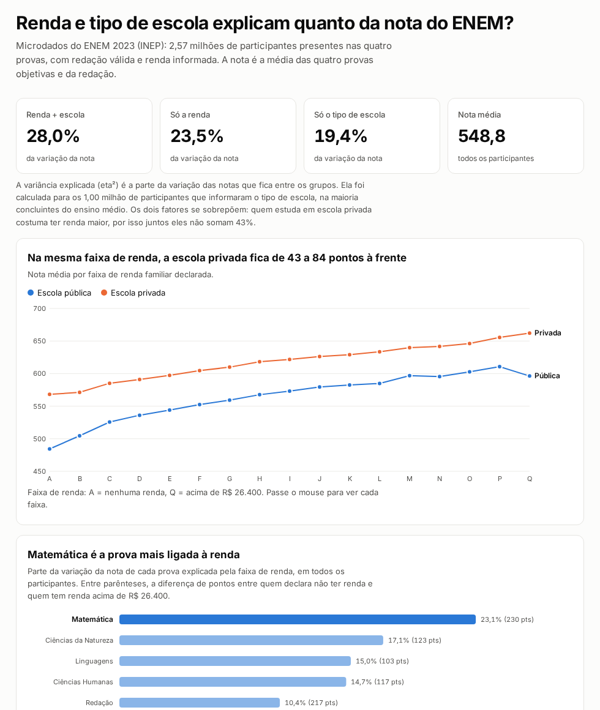

# Análise do ENEM 2023: renda, escola e nota

**Pergunta:** renda familiar e tipo de escola explicam quanto da nota do ENEM?

**📊 Página com os resultados:** https://luissfellipe.github.io/analise-enem/



## Principais resultados

| Fator | Variância da nota explicada |
|---|---|
| Tipo de escola | 19,4% |
| Renda familiar | 23,5% |
| Renda + escola | 28,0% |

- A nota média sobe em **todas** as 17 faixas de renda: de 490 pontos para quem declara não ter renda até 648 para quem tem renda acima de R$ 26.400.
- Mesmo dentro da mesma faixa de renda, quem estudou em escola privada tem média **43 a 84 pontos** maior.
- Em PI, CE, TO, AC, MA, AM, MT e GO a diferença entre escola privada e pública passa de 100 pontos.
- Os dois fatores juntos explicam pouco mais de um quarto da variação. Os outros 72% dependem de fatores que esta análise não mediu, e alguns deles estão nos microdados, como a escolaridade dos pais.
- **Matemática é a prova mais ligada à renda:** são 230 pontos entre as faixas extremas, e a renda explica 23,1% da variância da nota. A redação tem a segunda maior diferença em pontos (217), mas a renda explica só 10,4% dela, porque a nota da redação varia muito dentro de cada faixa.

A variância explicada da tabela foi calculada para o 1,0 milhão de participantes que informaram o tipo de escola, na maioria concluintes do ensino médio. A base completa tem 2,57 milhões.

A análise completa, com gráficos e limitações, está em [`notebooks/analise.ipynb`](notebooks/analise.ipynb).

## Arquitetura

```
INEP (zip, 550 MB)
   │  curl
   ▼
CSV 1,7 GB (latin-1, ;) ──► preparar/converter.py ──► enem_2023.parquet (50 MB, 16 colunas)
                                                          │
                                                          ▼
                              sql/01_participantes.sql  (limpeza: presentes, notas válidas)
                              sql/02_marts.sql          (agregações, window functions, eta²)
                                                          │
                                                          ▼
                                                    enem.duckdb
                                                    │         │
                                       notebook (análise)   dashboard Streamlit
                                                    │
                                    preparar/exportar_site.py ─► site/ (GitHub Pages)
```

## Decisões técnicas

- **DuckDB em vez de pandas** para os 3,9 milhões de linhas: o SQL roda direto sobre o Parquet, sem precisar carregar tudo em memória.
- **Parquet com só 16 das 76 colunas**: o arquivo cai de 1,7 GB para 50 MB, e o CSV bruto é apagado depois da conversão.
- **eta² em vez de regressão linear**: a renda vem em faixas ordinais de largura desigual. A variância entre grupos não depende de supor que a relação seja linear.
- **Streamlit em vez de Metabase**: o Metabase só lê DuckDB por meio de um plugin da comunidade.

## Como rodar

Requer [uv](https://docs.astral.sh/uv/).

```bash
make dados       # baixa, converte e monta o banco (~3 min)
make notebook    # reexecuta a análise
make dashboard   # abre em http://localhost:8501
make site        # regera o JSON da página e serve em http://localhost:8003
```

`make dados ANO=2022` roda a mesma análise para outro ano.
